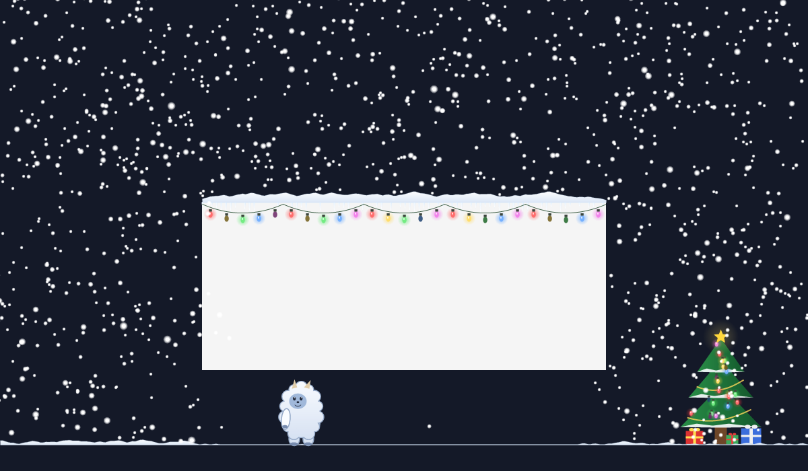
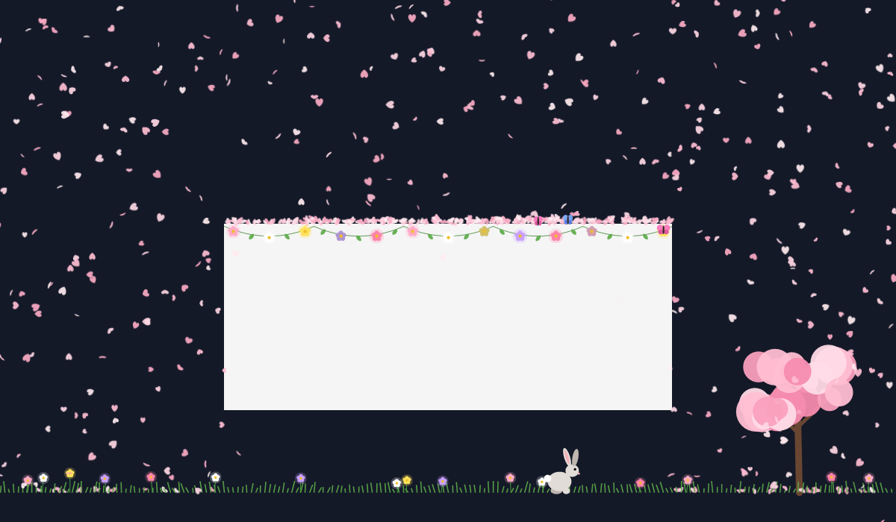
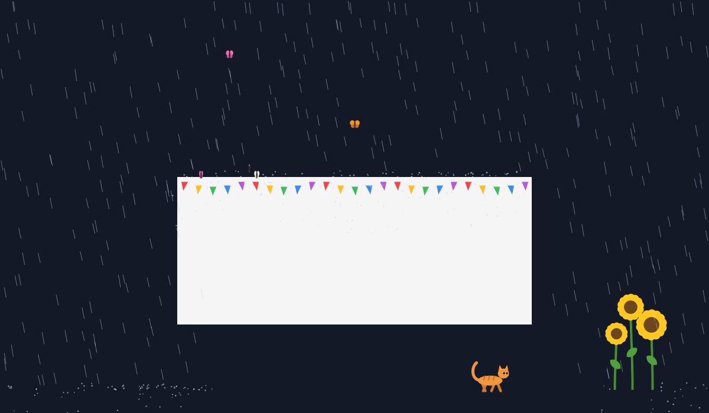
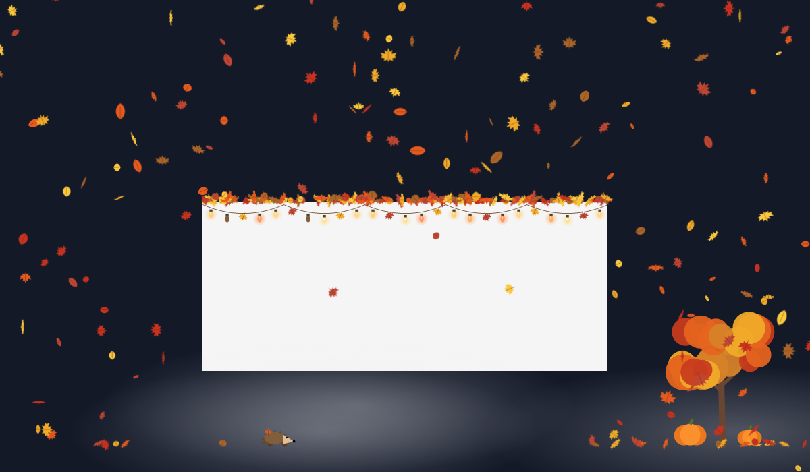

<p align="center">
  
</p>

<h1 align="center">DeskSeasons</h1>

<p align="center">
  Снег, листопад, цветение сакуры и летний дождь прямо поверх рабочего стола Windows.<br>
  Один маленький <code>.exe</code>, без установки, бесплатно и с открытым кодом.
</p>

<p align="center">
  <a href="../../releases/latest"><b>⬇ Скачать DeskSeasons.exe</b></a>
</p>

<p align="center"><i>Seasonal desktop overlay for Windows: snow piles up on your windows, leaves fall in autumn, sakura blooms in spring.</i></p>

---

| Зима | Весна |
|---|---|
|  |  |
| **Лето** | **Осень** |
|  |  |

## Что умеет

- **Эффекты поверх всех окон.** Клики проходят сквозь них, работать они не мешают.
- **Накопление на окнах.** Снег, листья и лепестки ложатся на верхние края окон и двигаются вместе с окном. Если окно вести плавно, снег держится. Если дёрнуть или потрясти окно, снег по инерции остаётся на месте и ссыпается комьями: чем сильнее рывок, тем больше слетает.
- **Накопление внизу экрана.** Над панелью задач растёт сугроб или ковёр из листьев. Когда его становится много, приезжает уборочная техника.
- **Курсор сметает** снег и листья. Если зажать <kbd>Alt</kbd>, появляется варежка, и она сметает всё начисто.
- **Снежки и снеговики** (зимой). Зажмите <kbd>Alt</kbd>, нажмите на сугроб и ведите мышью: катится снежок. Отпустите кнопку на ходу, и снежок полетит. Сложите снежки друг на друга внизу экрана, и получится снеговик.
- **Персонажи** иногда гуляют по низу экрана: Йети лепит своих снеговиков, а ёжик собирает листья на спину. Если навести на персонажа курсор, он остановится и помашет рукой.
- **Бой снежками** (зимой). Йети и снеговики кидаются снежками друг в друга и в курсор. Снежок, попавший «в экран», оставляет кляксу, которая сползает и тает. Попадите в Йети своим снежком: он пошатнётся и начнёт отвечать. Снеговик, в которого попали легонько, тоже ответит, а сильным броском его можно разбить. Бой можно отключить в настройках.
- **Гирлянды** на окнах или вдоль верхнего края экрана.
- **Не видно при демонстрации экрана.** В Zoom, Teams, Discord и на скриншотах эффектов нет.
- **Не мешает играм и видео.** В полноэкранных приложениях эффекты автоматически скрываются.
- **Исключения.** Можно указать программы, на окнах которых не будет гирлянд и сугробов, или чтобы при работе в них эффекты исчезали совсем.
- **Экономный режим.** Когда эффекты скрыты, программа «спит» и не тратит ресурсы.

## Времена года

Сезон выбирается автоматически по дате или вручную. У каждого сезона свои настройки.

| | ❄️ Зима | 🌸 Весна | ☀️ Лето | 🍂 Осень |
|---|---|---|---|---|
| **Погода** | снегопад, лёгкий снег, метель | сакура, дождь, лепестки с дождём | пух одуванчиков, дождь, гроза | листопад, дождь, листья с дождём |
| **Что копится** | снег | лепестки | — (дождь разбивается брызгами) | листья |
| **Гирлянда** | новогодние огоньки | цветочная | флажки | тёплые огоньки с листьями |
| **Декорация в углу** | ёлка с подарками | цветущая сакура | подсолнухи | клён и тыквы |
| **Персонаж** | Йети | зайчик | котик | ёжик |
| **Уборка** | снегоуборщик | газонокосилка | — | листоуборщик |
| **Дополнительно** | снежки, снеговики, сосульки | бабочки, трава с цветами | бабочки, молнии | туман |

Декорации в углу и туман по умолчанию выключены, их можно включить в настройках.

## Как пользоваться

1. Скачайте `DeskSeasons.exe` со страницы [Releases](../../releases/latest).
2. Запустите. Установка не нужна, файл можно положить куда угодно, например на рабочий стол.
3. Рядом с часами появится значок. Правая кнопка мыши открывает меню, двойной щелчок — настройки.

> Windows может предупредить: «Система Windows защитила ваш компьютер». Так бывает с любой программой без цифровой подписи. Нажмите **Подробнее → Выполнить в любом случае**.

### Горячие клавиши

| Клавиши | Действие |
|---|---|
| <kbd>Ctrl</kbd>+<kbd>Alt</kbd>+<kbd>S</kbd> | показать или скрыть эффекты |
| <kbd>Ctrl</kbd>+<kbd>Alt</kbd>+<kbd>W</kbd> | сменить погоду |
| <kbd>Ctrl</kbd>+<kbd>Alt</kbd>+<kbd>D</kbd> | следующий сезон |
| <kbd>Alt</kbd> + мышь | варежка и снежки (клавишу можно поменять в настройках) |

### Где хранятся настройки

По умолчанию — в `%APPDATA%\DeskSeasons\settings.ini`. Если включить **портативный режим**, настройки будут лежать в файле `DeskSeasons.ini` рядом с программой. Тогда можно скопировать оба файла на флешку и запускать с теми же настройками на любом компьютере.

## Требования

- Windows 10 версии 2004 или новее, либо Windows 11. На более старой Windows 10 всё работает, но эффекты будут видны при демонстрации экрана.
- .NET Framework 4.x. Он уже встроен в Windows 10 и 11, ничего ставить не нужно.
- Поддерживаются несколько мониторов и высокое разрешение экрана.

## Сборка из исходников

Visual Studio не нужна: компилятор C# входит в саму Windows.

```powershell
git clone https://github.com/stibba1337/DeskSeasons.git
cd DeskSeasons
powershell -ExecutionPolicy Bypass -File build.ps1
```

Готовый файл появится в `dist\DeskSeasons.exe`.

Чтобы посмотреть, сколько времени уходит на каждую часть кадра, задайте переменную окружения `DESKSEASONS_PROFILE=1` и запустите программу. Раз в 5 секунд итог пишется в `%TEMP%\DeskSeasons\profile.log`.

### Устройство проекта

| Файл | Что внутри |
|---|---|
| `src/Program.cs` | точка входа, запуск в одном экземпляре |
| `src/App.cs` | значок в трее, меню, горячие клавиши, главный цикл |
| `src/Overlay.cs` | прозрачные окна поверх экрана и поиск окон других программ |
| `src/World.cs`, `src/World2.cs` | симуляция: частицы, накопление, персонажи, техника |
| `src/WorldDraw.cs` | отрисовка всего, что видно на экране |
| `src/Art.cs` | заготовленные картинки и иконки |
| `src/Settings.cs` | настройки и их сохранение |
| `src/SettingsForm.cs` | окно настроек |

## Лицензия

[MIT](LICENSE): пользуйтесь, меняйте и распространяйте свободно.
